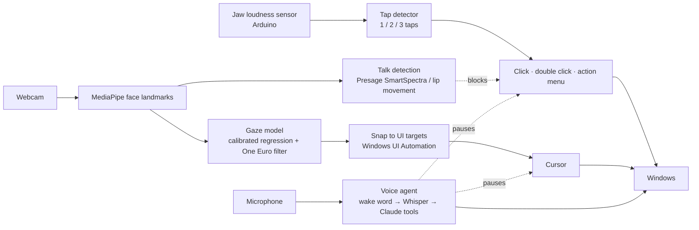

# Byte

**Hands-free computer control: look to point, tap your teeth to click, speak to command.**

Byte lets someone use a Windows PC without touching a mouse or keyboard. It uses a standard webcam, a small jaw sensor, and your voice:

- 👀 **Look** at something, and the cursor goes there (webcam eye tracking).
- 🦷 **Tap your teeth** to click. A loudness sensor on the jaw, read by an Arduino, picks up the taps.
- 🗣️ **Say "byte"** and a command, like "open Chrome", "write this down …" or "volume to 30", and a voice agent does it.

It's built for people with limited hand mobility, and for anyone who wants their hands free. Everything runs as one program, `python main.py`.

---

## Highlights

| | |
|---|---|
| **Eye-tracking cursor** | Webcam only, with no eye-tracker hardware. A 13-point calibration and smoothing get to about 1.5–3° of error. |
| **Jaw-tap clicks** | 1 tap clicks, 2 taps double-click, and 3 taps open an **action menu** (right click, drag/select, scroll, zoom) that you step through with taps. |
| **Snap to targets** | The cursor locks onto nearby buttons, links, text boxes, and every window's minimize/maximize/close, so small targets are easy to hit. Snapping holds through jitter but lets go when you look away. |
| **Talk-aware clicking** | Talking makes the jaw sensor noisy, so taps are ignored while you speak. The cursor keeps following your eyes. Talking is detected with Presage SmartSpectra, with a lip-movement fallback. |
| **Voice agent** | Wake word "byte" → local Whisper speech-to-text → Claude tool use. It opens apps and sites, searches, controls volume and brightness, switches tabs, and takes dictation that it cleans up and pastes. |
| **Built to work together** | While the voice agent works on a command, the cursor and clicks pause, so nothing moves under it or clicks focus away from the text box it's typing into. |

## How it fits together



## Requirements

- **Windows 10/11.** It uses Windows UI Automation and Win32 input.
- A **webcam**, ideally at eye level and with your face lit from the front.
- **Arduino** (Uno or similar) with a **Grove loudness sensor** on `A0`, worn against the jaw. Optional: without it, you get the eye cursor and voice.
- [Miniconda](https://docs.conda.io/en/latest/miniconda.html). [Node.js](https://nodejs.org) 20+ is also needed for Presage (optional).
- For the voice agent (optional): Python 3.12, an `ANTHROPIC_API_KEY`, and preferably an NVIDIA GPU for fast speech-to-text.

## Quick start

```bash
git clone https://github.com/Rai1975/byte.git
cd byte
conda env create -f environment.yml      # creates the "byte" env
conda activate byte
python main.py --no-clicks               # eye cursor only, no Arduino needed
```

Press **F8** to calibrate: sit how you normally will, press SPACE, and follow the dots with your eyes. Cursor control turns on afterwards.

### Optional extras

**API keys.** Put them in a `.env` file in the repo root. Git ignores it.

```text
PRESAGE_API_KEY=your-presage-key         # talking detection (physiology.presagetech.com)
ANTHROPIC_API_KEY=your-anthropic-key     # voice agent
```

**Presage** (talking detection). Without it, the lip-movement detector is used automatically.

```bash
cd presage && npm install && cd ..
```

**Jaw clicks.**
1. Connect the loudness sensor to **A0**.
2. Upload [`arduino/loudness/loudness.ino`](arduino/loudness/loudness.ino).
3. Close the Arduino Serial Monitor and App Lab, because only one program can use the port at a time.

Byte finds the COM port automatically. Pass `--port COMx` to choose one.

**Voice agent.** It has its own environment because of the GPU speech-to-text:

```powershell
cd voice_agent
py -3.12 -m venv .venv
.\.venv\Scripts\python -m pip install -r requirements.txt
cd ..
```

`python main.py` then starts the agent in the background, and stops it when you quit. See [voice_agent/README.md](voice_agent/README.md) for details.

**Run everything:** `python main.py`

## Using Byte

| Do this | Result |
|---------|--------|
| Look somewhere | Cursor moves there, and snaps onto a nearby button, link or text box (green box) |
| 1 tap | Left click |
| 2 quick taps | Double click |
| 3 quick taps | **Action menu** at the cursor (see below) |
| Talk | Taps are ignored. The cursor keeps moving. |
| Say "byte" + a command | The voice agent does it. The cursor **and** taps pause until it's done, plus 1 s. |

### Action menu (3 taps)

A ring of four options appears, with **Right click** highlighted. You choose with taps only:

| Taps | In the menu |
|------|-------------|
| **1 tap** | Move the highlight **clockwise**: Right click → Drag / select → Scroll → Zoom → Cancel → … |
| **2 taps** | **Choose** the highlighted option |
| **3 taps** | Cancel. The menu also closes 10 s after your last tap. |

| Option | What happens |
|--------|-------------|
| **Right click** | Right-clicks where you opened the menu |
| **Drag / select** | Holds the left button. Move with your eyes, then any tap drops. Use it for drag-and-drop, selecting text, or moving a window. |
| **Scroll** | Look above or below the menu point to scroll. Looking further scrolls faster. Any tap stops. |
| **Zoom** | A 3× magnified view. Look at the exact spot: 1 tap clicks, 2 taps double-click, 3 cancel. |

### Voice commands

Say **"byte"** (or "hey byte"), then the command straight away:

- **Apps:** "open Chrome", "close Notepad"
- **Web:** "go to youtube.com", "search for the weather", "next tab", "close tab"
- **System:** "volume to 30", "mute", "brightness 60", "take a screenshot", "minimize everything", "lock the screen"
- **Dictation:** click into a text box, then say "byte, write this down: …". Claude tidies up the grammar, filler words and self-corrections, then pastes the text.
- **Control:** "byte, stop listening" / "byte, resume"

The full list is in [voice_agent/README.md](voice_agent/README.md).

### Accuracy helpers

- **Clicks land where you were looking just before the tap.** The gaze is averaged over the third of a second before the first tap, so the head jolt from tapping doesn't move the click.
- **The cursor freezes** from the first tap until the click is done.
- **Snapping (F4 toggles it):**
  - It locks onto buttons, links, checkboxes, tabs, menu items, icons, **single-line text boxes**, and every window's **minimize / maximize / close** buttons. That includes apps that draw their own title bar (VS Code, Chrome, Discord) and don't report those buttons to Windows.
  - In a text box, the cursor slides along the box with your gaze, so you can still put the caret anywhere.
  - Big text areas never snap, so selecting text stays free.
  - It holds through jitter and quick glances, and lets go when you look about 130 px away for 0.3 s. Moving to a neighbouring button needs a deliberate look.
  - Tune it in [byte/snap.py](byte/snap.py) (`SNAP_IN_PX`, `SNAP_OUT_PX`, `RELEASE_S`, `SWITCH_DWELL_S`).

### Hotkeys

| Key (global) | Action |
|-----|--------|
| F4  | Snap to targets on/off |
| F5  | Jaw-tap clicks on/off |
| F6  | Pause-clicks-while-talking on/off |
| F7  | Cursor control on/off |
| F8  | Calibrate |
| F9  | Accuracy check |
| F10 | Quit |
| `[` / `]` | Less / more cursor smoothing (debug window focused) |
| `-` / `=` | Less / more responsiveness during fast moves |

Command-line options: `--no-clicks` (no Arduino), `--no-voice` (don't start the voice agent), `--port COM10`, `--camera 1`.

The function keys also reach the window you're in (F5 refreshes a browser page, for example). Click the debug window first if that matters.

## Testing each part

### Eye cursor

`python main.py --no-clicks`
1. Your eyes should show cyan outlines with green iris rings. "NO FACE" means you need to fix the lighting or camera angle.
2. Press **F8** to calibrate (13 dots). An accuracy check (9 dots) follows. Under 3° is good for a webcam.
3. **F7** turns the cursor on and off. **F10** or `q` quits.

The calibration is saved to `calibration.json` and reloaded next time. Recalibrate after you move the laptop or chair, or when the lighting changes.

### Arduino sensor

`python tools/sensor_stream.py` should show `Listening on COMx`, a bar that jumps when you tap your teeth, and a `readings/s` line.

| Problem | Fix |
|---------|-----|
| `No Arduino found` | Check the USB cable, or pass `--port COMx`. |
| `No data` or `Access denied` | Close App Lab, the Serial Monitor, and any other running `main.py` or `tap_plot.py`. |

### Jaw-tap detection

`python tools/tap_plot.py` shows a live graph with no real clicks. Add `--click` to also send real clicks, which **F8** toggles.
1. Sit still and quiet for 10 s. The blue signal should stay under the red threshold line.
2. Tap once, twice and three times. The label should show `SINGLE`, `DOUBLE` and `TRIPLE`.

Tuning lives at the top of [byte/jaw_clicker.py](byte/jaw_clicker.py):

| Symptom | Change |
|---------|--------|
| Taps fire while you sit still | Raise `THRESHOLD` (default 15) |
| Real taps are missed | Lower `THRESHOLD` |
| Doubles come out as two singles | Raise `CLICK_GAP_MS` (default 250) |
| Two separate clicks merge into a double | Lower `CLICK_GAP_MS` |

### Talking blocks clicks

`python main.py --no-voice`, then talk while tapping.
- You should see a red **TALKING - CLICKS PAUSED** banner and taps logged as `blocked: talking`.
- The cursor keeps moving.
- The `talk detect [...]` line shows which detector is active (`presage` or `local`).

### Voice agent

1. On its own: `voice_agent\.venv\Scripts\python voice_agent\agent.py --text "volume to 30"` should change the volume.
2. Run `voice_agent\.venv\Scripts\python voice_agent\agent.py --test-wake` and say "byte" 10 times. You want about 10 hits, and none while you chat normally.
3. In the app (`python main.py`), say **"byte, open Notepad"**. A magenta **VOICE AGENT** banner appears, and the cursor and taps pause until Notepad opens.

## The debug window

- **Camera view:**
  - Eye outlines, irises and head direction.
  - A green `TAP: …` banner for each gesture.
  - A red border while you're talking (clicks paused).
  - A magenta border while the voice agent works (everything paused). It shows `dictation mode` for typing commands.
- **Screen minimap:** red is the raw gaze, green is smoothed, and the white cross is the cursor.
- **Status lines:**
  - fps, `snap:` and `mode:`
  - Calibration error and smoothing
  - Talk detector
  - Jaw sensor: port, readings/s, taps, blocked taps, and a mini graph of the signal
  - Voice agent state

## How it works

**Eye cursor**
1. MediaPipe FaceLandmarker returns 478 face points, including the irises, plus head pose.
2. The features are each iris's position inside its eye (normalized for head tilt and distance), eye openness, and head yaw and pitch.
3. A ridge regression fitted from the 13-point calibration maps those features to screen coordinates.
4. A One Euro filter smooths the estimate, and a 120 Hz thread glides the cursor toward it.
5. The webcam runs at 640×480, because many laptop cameras only give 30 fps at that size.

**Jaw clicks**
1. The Arduino streams loudness readings as fast as it can, from a few hundred to tens of thousands per second.
2. The readings are averaged into ~1 ms ticks.
3. A fast envelope minus a slow one has to jump above the threshold to count as a tap. Subtracting the slow envelope cancels out humming or a voice.
4. Taps within 250 ms of each other form a single, double or triple gesture.

**Snapping**
1. A background thread asks Windows UI Automation what's at the gaze point and at 8 points around it, about 10 times a second.
2. For apps that don't report their title bar buttons, minimize/maximize/close are worked out from each nearby window's position and display scaling. They're skipped where another window covers them.
3. The cursor locks on after a short dwell, using in/out zones so it doesn't flicker.

**Talk detection**
1. Webcam frames go to a small Node process that runs the Presage SmartSpectra `TALKING` metric.
2. It restarts Presage automatically after recoverable errors.
3. When Presage isn't available, a detector that counts lip open/close cycles takes over.

**Voice agent**
1. Wake word ("byte") → record until you pause → Whisper on the GPU.
2. Common commands run instantly. Everything else goes to Claude, which calls a fixed set of safe tools: apps, URLs, keys, volume, brightness, dictation.
3. The agent reports `busy` on `http://127.0.0.1:8765/status`. Byte checks it 10 times a second, and pauses the cursor and clicks while it's busy plus 1 s. If the agent ever stops answering, the pause is released, so you can't get stuck.

## Project structure

```text
main.py                    start Byte (eye cursor + jaw clicks + voice agent)
byte/
  app.py                   eye tracking, cursor driver, calibration, debug window; wires it all up
  jaw_clicker.py           jaw-tap detector (reads the Arduino over USB serial)
  actions.py               what taps do: click, double click, action menu, drag, scroll, zoom
  snap.py                  snapping to buttons, links, text boxes and caption buttons
  overlay.py               transparent on-screen layer: menu, snap highlight, zoom view
  talk_detect.py           talking detection (Presage + lip-movement fallback)
  voice_link.py            starts the voice agent and pauses input while it's busy
voice_agent/               wake word, local Whisper, Claude tool use, dictation (own venv)
presage/talk_bridge.mjs    Node bridge to the Presage SDK (the SDK is Node-only)
arduino/loudness/          Arduino sketch that streams the loudness sensor
tools/
  sensor_stream.py         check the Arduino is sending data
  tap_plot.py              live graph of the tap detector, for testing and tuning
models/face_landmarker.task  MediaPipe face model
environment.yml            conda environment ("byte")
```

## Built with

MediaPipe · OpenCV · NumPy · pynput · Windows UI Automation · Presage SmartSpectra · Arduino · faster-whisper · sherpa-onnx · Claude (Anthropic API)

## Tips for accuracy

- Light your face from the front, and avoid a bright window behind you.
- Put the webcam at eye level if you can, and sit fairly close.
- Calibrate in the posture you'll actually use, and recalibrate if you move.
- Webcam eye tracking reaches about 1.5–3° of error, so snapping and large targets help a lot.

---

Built at the MakeUC hackathon (MLH).
